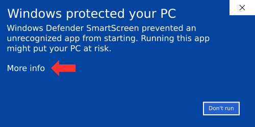
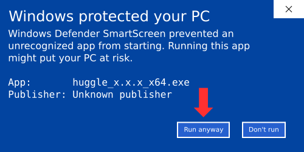

# Smart Language Switcher

A small Windows 11 tray app. Switch to your previous keyboard layout, or hold the modifier and tap again to cycle.

**[Download EXE](https://github.com/par-n-go/SmartLanguageSwitcher/releases/latest/download/SmartLanguageSwitcher.exe)** · [Release notes](https://github.com/par-n-go/SmartLanguageSwitcher/releases/latest)

- Choose **Alt+Shift**, **Ctrl+Shift**, or **Win+Space**.
- Release the modifier to confirm. Double-click the tray icon for settings.
- Auto-updates check GitHub on launch and every six hours. Disable in settings.
- **Check for updates** in Settings checks immediately, even with auto-update off.
- Put the EXE in a permanent folder before enabling **Start with Windows**.

**Limits:** Disable the matching Windows Alt+Shift/Ctrl+Shift shortcut. Win+Space is best effort. Some elevated apps and IMEs may reject switching.

**Why ~50 MB?** The EXE bundles the .NET 10 Desktop Runtime, including Windows Forms, so no separate runtime installation is needed. Most of the download is the runtime, not the switcher itself.

<details>
<summary>First launch: “Windows protected your PC”</summary>

The EXE is unsigned, so SmartScreen may flag it as unrecognized. If you downloaded it from this repository's [Releases](https://github.com/par-n-go/SmartLanguageSwitcher/releases/latest) and trust it:

1. Select **More info**.
2. Check that the app is **SmartLanguageSwitcher.exe**, then select **Run anyway**.

| 1. More info | 2. Run anyway |
| --- | --- |
|  |  |

English SmartScreen illustrations; appearance varies by Windows version. [Image sources](docs/DETAILS.md#image-sources).

This permits this launch; it does not sign the app or guarantee future warnings disappear. If **Run anyway** is unavailable, or antivirus reports a specific threat, these steps do not apply. Keep Windows protection enabled. [Microsoft guidance](https://learn.microsoft.com/en-us/windows/apps/package-and-deploy/smartscreen-reputation).

</details>

### Build

Requires Windows and .NET 10 SDK.

```powershell
dotnet publish SmartLanguageSwitcher -c Release -r win-x64 --self-contained true -p:PublishSingleFile=true -p:IncludeNativeLibrariesForSelfExtract=true -o publish
./scripts/Validate.ps1
```

[Technical details](docs/DETAILS.md) · [MIT license](LICENSE)
